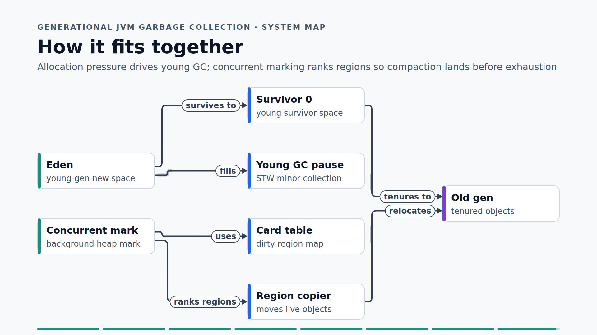

# Qwen Video Shotcraft

A weak-model wrapper for local LLMs, tuned on qwen3.8-27b. It turns a filled content graph into an animated technical explainer video using the upstream video-shotcraft renderer's Remotion stack.

## Install

From this directory, run `scripts/setup.sh`. Requires Node.js/npm, ffmpeg/ffprobe, and DejaVu Sans; setup installs the pinned Remotion dependencies locally.

## Use

Copy `templates/content.json` to a work directory, replace its text, then ask: “Use the qwen-video-shotcraft skill to make a video about [topic]; save the content and render output in [work directory].” Follow `SKILL.md` and run `scripts/make.sh <work>/content.json <work>/output`.

## Results

Best version: v3, overall 5.3/10. Qwen3.8-27b iterations were assessed by an AI critic (not benchmarks): v1 4.5, v2 5.0, v3 5.3. Scores are subjective critic assessments, not objective performance measures.

## License

This fork adds `qwen-video-shotcraft/`, a portable wrapper skill and setup workflow, and does not alter the upstream license for upstream files. The wrapper's additions are modifications for purposes of Apache-2.0 section 4(b).
